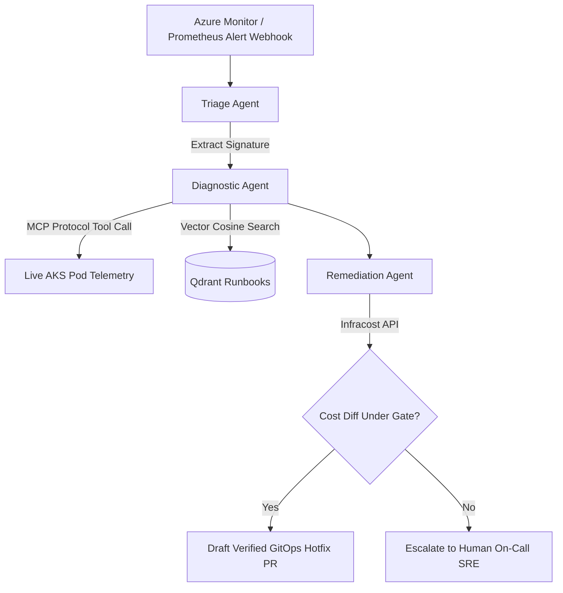

# 🤖 Agentic DevSecOps Copilot

Autonomous Multi-Agent Incident Response & Infrastructure Self-Healing platform driven by Anthropic's **Model Context Protocol (MCP)**, **LangGraph Swarms**, and modular **Terraform** infrastructure.

---

## ⚡ Architectural Workflow

---

## 🚀 Key Features

* **Autonomous SRE Operations:** Intercepts real-time alert webhooks, extracts failure patterns, matches historical resolution runbooks, and synthesizes root-cause analyses.
* **Model Context Protocol (MCP):** Exposes live diagnostic tools (`inspect_pod_telemetry`, `calculate_infracost_diff`, `draft_gitops_hotfix_pr`) via standard MCP.
* **Terraform Modular Infrastructure (`terraform/`):**
  * `for_each`: Multi-model cognitive account provisioning (`gpt-4o`, `text-embedding-3-small`).
  * `dynamic "env"`: Dynamic container environment variables.
  * Conditional iteration: Optional Qdrant vector database container deployment.
* **Impact:** Slashes Mean Time to Resolution (MTTR) from **45 minutes to under 5 minutes**.

---

## 🛠️ Repository Layout

- [`server.py`](./server.py): Model Context Protocol (MCP) server providing live telemetry inspection tools.
- [`agent.py`](./agent.py): LangGraph Multi-Agent state orchestration engine.
- [`terraform/`](./terraform/): Modular Terraform infrastructure deploying Azure OpenAI, Log Analytics, and Azure Container Apps.

---

## 👤 Author

**Rishikesh Sharma**  
Senior DevSecOps Engineer & Cloud Solutions Architect  
[GitHub Profile](https://github.com/RisikeshSharma) · [LinkedIn](https://www.linkedin.com/in/rishikesh-sharma-devsecops)
